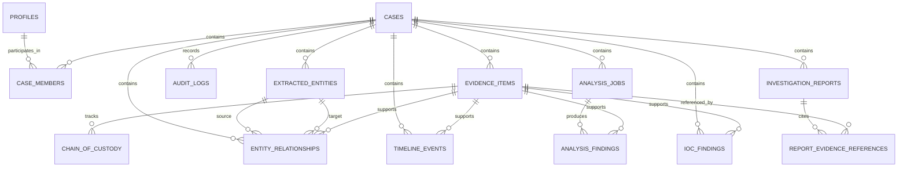

# Database Schema
## Cyber Investigation & Digital Forensics Platform

**Version:** 1.0  
**Status:** Proposed  
**Database:** PostgreSQL / Supabase  
**Project:** Cyber Investigation & Digital Forensics Platform

---

## 1. Purpose

This document defines the proposed database structure for the Cyber Investigation & Digital Forensics Platform.

The database must support case management, evidence metadata, chain of custody, audit logging, analytical findings, entity relationships, incident timelines, threat intelligence, and AI-assisted reports.

The schema uses PostgreSQL through Supabase as the structured data store. Evidence files are stored separately in private Supabase Storage, while the database stores their metadata and storage references.

This document describes the intended schema. Before implementing migrations, compare it with the existing repository and database to avoid duplicating or damaging existing tables.

## 2. Database Design Principles

1. Every investigation record must belong to the appropriate case wherever applicable.
2. Evidence files must remain separate from their structured metadata.
3. Extracted artifacts and analytical findings must retain source evidence references.
4. Primary keys and foreign keys must maintain referential integrity.
5. Case access must be enforced using server-side authorization and appropriate database policies.
6. Important evidence-handling events must be recorded for traceability.
7. Original evidence must not be silently overwritten during analysis.
8. Timestamps must use a consistent timezone strategy.
9. Large result sets must support appropriate indexing and pagination.
10. AI-generated content must remain distinguishable from source evidence and verified findings.

## 3. High-Level Entity Relationships

**Relationship note:** This diagram is conceptual. A finding may be supported by multiple evidence items, and relationships may have multiple supporting sources. The final implementation should use junction tables where necessary rather than assuming a single evidence reference is sufficient.

---

## 4. Common Database Conventions

### Primary Keys

Use UUID primary keys for application entities where appropriate.

### Timestamps

Use `TIMESTAMPTZ` for timestamps representing actual points in time. Preserve original source timestamps and timezone information when required for forensic interpretation.

### Foreign Keys

Use explicit foreign keys for relationships between cases, users, evidence, entities, events, and reports.

### Indexes

Create indexes for frequently used lookup columns, including:

- Case identifiers.
- Evidence identifiers.
- User and membership identifiers.
- Entity identifiers and types.
- Relationship endpoints.
- Timeline timestamps.
- Analysis job statuses.
- IOC values and types.

### Data Validation

Use appropriate database constraints, application validation, and explicit handling of null values. Do not rely on frontend validation alone.

---

## 5. Table: `profiles`

### Purpose

Stores application-level user information associated with the authentication system.

| Column | Type | Constraints / Description |
|---|---|---|
| `id` | UUID | Primary key; linked to the authentication user identifier |
| `full_name` | TEXT | Display name |
| `role` | TEXT | Application role, such as investigator or administrator |
| `created_at` | TIMESTAMPTZ | Creation timestamp |
| `updated_at` | TIMESTAMPTZ | Last update timestamp |

### Rules

- The profile identifier should correspond to the authenticated user's identifier.
- Role changes must be authorized.
- The application must not trust a role supplied by the client.
- Use a constrained role definition or a suitable database enum when the role model is finalized.

---

## 6. Table: `cases`

### Purpose

Stores investigation case metadata.

| Column | Type | Constraints / Description |
|---|---|---|
| `id` | UUID | Primary key |
| `case_number` | TEXT | Unique human-readable case reference |
| `title` | TEXT | Required case title |
| `description` | TEXT | Case description |
| `status` | TEXT | Case status |
| `created_by` | UUID | References `profiles.id` |
| `created_at` | TIMESTAMPTZ | Creation timestamp |
| `updated_at` | TIMESTAMPTZ | Last update timestamp |
| `closed_at` | TIMESTAMPTZ | Optional closure timestamp |

### Rules

- Case creation requires authorization.
- Only authorized members can access case details.
- Status transitions should follow defined business rules.
- Case deletion must not silently destroy evidence or audit history.
- Case identifiers must remain stable across modules.

---

## 7. Table: `case_members`

### Purpose

Defines which users can access each investigation case.

| Column | Type | Constraints / Description |
|---|---|---|
| `id` | UUID | Primary key |
| `case_id` | UUID | References `cases.id` |
| `user_id` | UUID | References `profiles.id` |
| `access_role` | TEXT | Role within the case |
| `created_at` | TIMESTAMPTZ | Membership creation timestamp |

### Rules

- Enforce uniqueness on `(case_id, user_id)`.
- Define permissions for reading evidence, uploading files, running analysis, and reviewing reports.
- Verify membership before allowing protected case operations.
- Changes to membership must be authorized and auditable.

---

## 8. Table: `evidence_items`

### Purpose

Stores evidence metadata and references to files held in private storage.

| Column | Type | Constraints / Description |
|---|---|---|
| `id` | UUID | Primary key |
| `case_id` | UUID | References `cases.id` |
| `evidence_number` | TEXT | Human-readable evidence reference |
| `original_filename` | TEXT | Original filename as received |
| `storage_bucket` | TEXT | Private storage bucket |
| `storage_path` | TEXT | Storage object path |
| `mime_type` | TEXT | Detected or validated media type |
| `file_size_bytes` | BIGINT | File size in bytes |
| `sha256_hash` | CHAR(64) | SHA-256 hash of the received file |
| `source_description` | TEXT | Recorded source information |
| `acquired_at` | TIMESTAMPTZ | Source acquisition time, if known |
| `received_at` | TIMESTAMPTZ | Time the application received the file |
| `uploaded_by` | UUID | References `profiles.id` |
| `status` | TEXT | Evidence processing or lifecycle status |
| `created_at` | TIMESTAMPTZ | Database creation timestamp |

### Rules

- Store file contents in private storage, not as database text or binary fields by default.
- Enforce uniqueness for evidence references within the appropriate case scope.
- Validate file size and allowed formats.
- Keep original evidence separate from derived files.
- Recompute hashes when verifying file integrity.
- Do not assume that a matching hash independently proves the evidence's origin or authenticity.
- Avoid storing permanent public URLs for private evidence.

---

## 9. Table: `chain_of_custody`

### Purpose

Records relevant evidence-handling and transfer events.

| Column | Type | Constraints / Description |
|---|---|---|
| `id` | UUID | Primary key |
| `case_id` | UUID | References `cases.id` |
| `evidence_id` | UUID | References `evidence_items.id` |
| `actor_user_id` | UUID | References `profiles.id`, when applicable |
| `action_type` | TEXT | Type of evidence-handling event |
| `event_timestamp` | TIMESTAMPTZ | Event timestamp |
| `details` | JSONB | Structured event details |
| `previous_hash` | CHAR(64) | Optional previous record hash |
| `record_hash` | CHAR(64) | Optional record integrity hash |
| `created_at` | TIMESTAMPTZ | Record creation timestamp |

### Rules

- Record relevant receipt, transfer, access, verification, and processing events.
- Preserve the identity of the actor and the event time where available.
- Restrict modification and deletion of historical records.
- Do not claim tamper-proof storage merely because a hash column exists.
- If tamper evidence is required, define and test an appropriate hash-linking or external integrity mechanism.

---

## 10. Table: `audit_logs`

### Purpose

Records relevant application and security events.

| Column | Type | Constraints / Description |
|---|---|---|
| `id` | UUID | Primary key |
| `case_id` | UUID | Optional reference to `cases.id` |
| `actor_user_id` | UUID | Optional reference to `profiles.id` |
| `action` | TEXT | Action performed |
| `resource_type` | TEXT | Type of resource affected |
| `resource_id` | UUID | Identifier of the affected resource, where applicable |
| `outcome` | TEXT | Success or failure |
| `details` | JSONB | Limited, non-sensitive event metadata |
| `created_at` | TIMESTAMPTZ | Event timestamp |

### Rules

- Record important security, access, administrative, and evidence-handling events.
- Avoid logging passwords, access tokens, service-role keys, or unnecessary sensitive evidence content.
- Restrict write and delete permissions.
- Where appropriate, log denied access attempts without disclosing protected data.
- Define retention and review policies.

---

## 11. Table: `extracted_entities`

### Purpose

Stores normalized entities extracted from evidence or imported records.

| Column | Type | Constraints / Description |
|---|---|---|
| `id` | UUID | Primary key |
| `case_id` | UUID | References `cases.id` |
| `entity_type` | TEXT | Person, phone, email, IP, domain, username, device, or other supported type |
| `normalized_value` | TEXT | Normalized entity value |
| `display_value` | TEXT | Display representation |
| `attributes` | JSONB | Relevant non-sensitive attributes |
| `created_at` | TIMESTAMPTZ | Creation timestamp |
| `updated_at` | TIMESTAMPTZ | Last update timestamp |

### Rules

- Entity normalization must depend on the entity type.
- Preserve original values in associated source records when needed.
- Do not automatically merge uncertain identities.
- Avoid storing unnecessary personal information.
- Consider a uniqueness constraint only after defining reliable entity-resolution rules.

---

## 12. Table: `entity_relationships`

### Purpose

Represents relationships between entities within a case.

| Column | Type | Constraints / Description |
|---|---|---|
| `id` | UUID | Primary key |
| `case_id` | UUID | References `cases.id` |
| `source_entity_id` | UUID | References `extracted_entities.id` |
| `target_entity_id` | UUID | References `extracted_entities.id` |
| `relationship_type` | TEXT | Type of relationship |
| `description` | TEXT | Optional relationship description |
| `confidence` | NUMERIC | Optional confidence value |
| `derivation_type` | TEXT | Observed, extracted, or inferred |
| `created_at` | TIMESTAMPTZ | Creation timestamp |

### Supporting Evidence

A relationship may be supported by multiple evidence items. Use the following junction table.

### Table: `relationship_evidence`

| Column | Type | Constraints / Description |
|---|---|---|
| `id` | UUID | Primary key |
| `relationship_id` | UUID | References `entity_relationships.id` |
| `evidence_id` | UUID | References `evidence_items.id` |
| `source_locator` | TEXT | Optional record, message, row, or artifact reference |
| `created_at` | TIMESTAMPTZ | Creation timestamp |

### Rules

- Prevent invalid references and self-links where the relationship model does not permit them.
- Validate that related entities and supporting evidence belong to the appropriate case.
- Define the meaning and permitted range of confidence values.
- Distinguish directly observed relationships from inferred relationships.
- Preserve source locators when relationships originate from individual records.

---

## 13. Table: `timeline_events`

### Purpose

Stores timestamped events extracted from different evidence sources.

| Column | Type | Constraints / Description |
|---|---|---|
| `id` | UUID | Primary key |
| `case_id` | UUID | References `cases.id` |
| `evidence_id` | UUID | Optional reference to `evidence_items.id` |
| `entity_id` | UUID | Optional reference to `extracted_entities.id` |
| `event_type` | TEXT | Type of event |
| `event_time` | TIMESTAMPTZ | Normalized event time, when known |
| `source_timestamp` | TEXT | Original timestamp representation |
| `source_timezone` | TEXT | Source timezone, if known |
| `time_precision` | TEXT | Precision or uncertainty classification |
| `description` | TEXT | Event description |
| `source_locator` | TEXT | Reference to the source record |
| `created_at` | TIMESTAMPTZ | Record creation timestamp |

### Rules

- Preserve original timestamp information.
- Do not fabricate timestamps for records that lack reliable time information.
- Distinguish event time from evidence collection time.
- Define how ambiguous timestamps are represented.
- Index `case_id` and `event_time` for common timeline queries.

---

## 14. Table: `analysis_jobs`

### Purpose

Tracks the execution and status of analysis operations.

| Column | Type | Constraints / Description |
|---|---|---|
| `id` | UUID | Primary key |
| `case_id` | UUID | References `cases.id` |
| `module_type` | TEXT | Analysis module |
| `status` | TEXT | Pending, running, completed, or failed |
| `requested_by` | UUID | References `profiles.id` |
| `input_metadata` | JSONB | Validated input references and configuration |
| `started_at` | TIMESTAMPTZ | Processing start time |
| `completed_at` | TIMESTAMPTZ | Processing completion time |
| `error_code` | TEXT | Optional non-sensitive error code |
| `error_message` | TEXT | Optional safe error message |
| `created_at` | TIMESTAMPTZ | Job creation timestamp |

### Rules

- Validate module type and status values.
- Enforce case authorization before creating or retrieving jobs.
- Do not place raw evidence contents or secrets in job metadata.
- Ensure failed jobs are not displayed as completed.
- Consider a background worker only if actual processing duration requires it.

---

## 15. Table: `analysis_findings`

### Purpose

Stores structured results produced by analysis modules.

| Column | Type | Constraints / Description |
|---|---|---|
| `id` | UUID | Primary key |
| `case_id` | UUID | References `cases.id` |
| `job_id` | UUID | References `analysis_jobs.id` |
| `evidence_id` | UUID | Optional source evidence reference |
| `finding_type` | TEXT | Type of finding |
| `title` | TEXT | Short finding title |
| `description` | TEXT | Finding description |
| `result_data` | JSONB | Structured analytical output |
| `derivation_type` | TEXT | Observed, extracted, or inferred |
| `created_at` | TIMESTAMPTZ | Creation timestamp |

### Rules

- Validate the structure of `result_data` according to finding type.
- Preserve source references.
- Distinguish raw observations from derived interpretations.
- Associate findings with the relevant analysis job.
- Avoid storing unsupported conclusions as verified findings.

---

## 16. Table: `ioc_findings`

### Purpose

Stores Indicators of Compromise and associated threat intelligence matches.

| Column | Type | Constraints / Description |
|---|---|---|
| `id` | UUID | Primary key |
| `case_id` | UUID | References `cases.id` |
| `evidence_id` | UUID | Optional source evidence reference |
| `indicator_type` | TEXT | IP, domain, URL, file hash, or another supported type |
| `indicator_value` | TEXT | Normalized indicator |
| `intelligence_source` | TEXT | Source or feed identifier |
| `source_reference` | TEXT | Source record or reference |
| `confidence` | NUMERIC | Optional source-defined or method-defined confidence |
| `first_seen_at` | TIMESTAMPTZ | First-seen time when available |
| `last_seen_at` | TIMESTAMPTZ | Last-seen time when available |
| `retrieved_at` | TIMESTAMPTZ | Intelligence retrieval time |
| `created_at` | TIMESTAMPTZ | Database creation timestamp |

### Rules

- Validate indicators according to their type.
- Preserve source attribution and retrieval time.
- Define the meaning and range of confidence values.
- Do not equate an intelligence match with proof of malicious activity.
- Avoid transmitting sensitive case data to external intelligence services without authorization.

---

## 17. Table: `investigation_reports`

### Purpose

Stores draft and reviewed investigation reports.

| Column | Type | Constraints / Description |
|---|---|---|
| `id` | UUID | Primary key |
| `case_id` | UUID | References `cases.id` |
| `title` | TEXT | Report title |
| `content` | TEXT | Report body |
| `status` | TEXT | Draft, under review, or approved |
| `generated_by` | UUID | References `profiles.id` |
| `reviewed_by` | UUID | Optional reference to `profiles.id` |
| `generated_at` | TIMESTAMPTZ | Generation timestamp |
| `reviewed_at` | TIMESTAMPTZ | Optional review timestamp |
| `created_at` | TIMESTAMPTZ | Record creation timestamp |
| `updated_at` | TIMESTAMPTZ | Last update timestamp |

### Supporting Evidence

A report may cite multiple evidence items. Use the following junction table.

### Table: `report_evidence_references`

| Column | Type | Constraints / Description |
|---|---|---|
| `id` | UUID | Primary key |
| `report_id` | UUID | References `investigation_reports.id` |
| `evidence_id` | UUID | References `evidence_items.id` |
| `reference_label` | TEXT | Citation label used in the report |
| `source_locator` | TEXT | Optional record or artifact reference |
| `created_at` | TIMESTAMPTZ | Creation timestamp |

### Rules

- Distinguish AI-generated drafts from reviewed reports.
- Require appropriate permissions for report generation and approval.
- Ensure cited evidence identifiers refer to real records.
- Preserve review status and relevant audit history.
- Define whether approved reports are immutable or require versioning for changes.

---

## 18. Authentication and Row-Level Security

Supabase authentication and PostgreSQL row-level security must work together with backend authorization.

### Required Principles

1. Enable row-level security on sensitive tables where appropriate.
2. Allow users to access cases only when authorized by the application's membership rules.
3. Apply equivalent protection to evidence, analysis results, relationships, timeline events, IOCs, and reports.
4. Validate authorization in FastAPI before performing protected operations.
5. Prevent client-supplied case IDs from bypassing membership checks.
6. Restrict privileged service credentials to trusted server-side environments.
7. Ensure private storage policies enforce case-level evidence access.
8. Test policies using different users and roles.

Do not assume that hiding a button in the frontend protects its underlying data.

The exact policies must be designed against the actual Supabase authentication configuration and deployment model.

---

## 19. Recommended Indexes and Constraints

Implement indexes based on actual query patterns.

Recommended candidates include:

- Unique index on `cases.case_number`.
- Unique constraint on `(case_id, user_id)` in `case_members`.
- Index on `evidence_items.case_id`.
- Index on `chain_of_custody.evidence_id` and event timestamp.
- Index on `audit_logs.created_at`.
- Index on `extracted_entities.case_id` and `entity_type`.
- Indexes on both relationship endpoints.
- Index on `timeline_events(case_id, event_time)`.
- Index on `analysis_jobs(case_id, status)`.
- Index on `analysis_findings(job_id)`.
- Index on `ioc_findings(case_id, indicator_type, indicator_value)`.
- Index on `investigation_reports.case_id`.

Before adding uniqueness constraints or specialized indexes, verify that existing data and query patterns support them.

---

## 20. Data Retention and Deletion

Evidence and investigation records may require stricter retention controls than ordinary application data.

- Define retention requirements before enabling automated deletion.
- Restrict case deletion and evidence removal.
- Preserve relevant audit and custody records.
- Define a documented process for correcting metadata.
- Record authorized deletion or disposal events where required.
- Avoid deleting referenced evidence without an explicit, approved workflow.
- Ensure backups and retention policies align with the project's actual requirements.

---

## 21. Migration Strategy

Database changes must be implemented through version-controlled migrations.

### Migration Rules

1. Inspect the existing database schema before creating tables.
2. Reuse existing tables when their purpose and structure already match.
3. Create migrations in a clear, sequential order.
4. Add constraints and indexes deliberately.
5. Test migrations in a development environment.
6. Review the effect of migrations on existing records and policies.
7. Do not reset or drop production tables to resolve migration errors.
8. Test rollback or recovery procedures where feasible.
9. Update this document when the approved schema changes.

Never assume that a proposed table is absent from the current database.

---

## 22. Schema Validation Checklist

Before considering the database schema complete, verify:

- [ ] All ten modules can store and retrieve their required data.
- [ ] Every case-specific record is associated with the correct case.
- [ ] Evidence files remain in private storage.
- [ ] Evidence hashes can be recomputed and compared.
- [ ] Chain-of-custody records retain their relevant history.
- [ ] Entity relationships can reference multiple supporting evidence items.
- [ ] Timeline events preserve source timestamp information.
- [ ] Analysis jobs and findings retain processing status and provenance.
- [ ] IOC matches retain source attribution.
- [ ] Reports can reference their supporting evidence.
- [ ] Case-level authorization and database policies are tested.
- [ ] Foreign keys, constraints, and indexes are appropriate.
- [ ] Migrations do not damage existing data.

---

## 23. Implementation Status

This document describes the proposed database design. It does not confirm that the listed tables, columns, indexes, or policies already exist.

The final implementation must be based on the current repository, existing database, confirmed requirements, and tested migrations.

**Related documents:**

- `PROJECT_OVERVIEW.md`
- `SYSTEM_ARCHITECTURE.md`
- `MODULE_SPECIFICATION.md`
- `UI_UX_DESIGN_SYSTEM.md`
- `IMPLEMENTATION_ROADMAP.md`