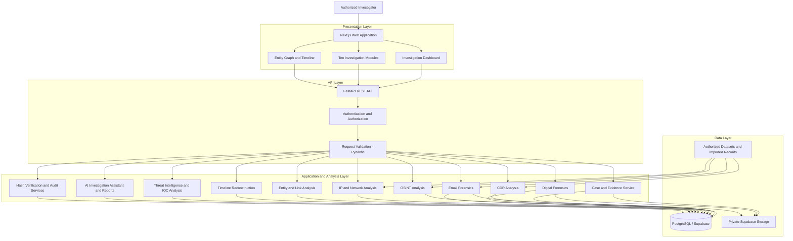

# System Architecture
## Cyber Investigation & Digital Forensics Platform

**Document Type:** System Architecture Specification  
**Project:** Cyber Investigation & Digital Forensics Platform  
**Status:** Proposed Architecture  
**Version:** 1.0

---

## 1. Architecture Overview

The Cyber Investigation & Digital Forensics Platform follows a modular, layered web application architecture. The system integrates case management, evidence processing, analytical services, relationship visualization, incident reconstruction, threat intelligence, and AI-assisted reporting within a centralized investigation workspace.

The architecture separates the frontend, backend API, business logic, analysis services, database, and evidence storage. This separation improves maintainability, security, testing, and the ability to develop individual modules independently.

### Core Architectural Layers

1. Presentation Layer — Next.js, React, TypeScript, and Tailwind CSS.
2. API Layer — FastAPI and Pydantic.
3. Application and Analysis Layer — Python-based investigation services and analytical libraries.
4. Data Layer — PostgreSQL/Supabase.
5. Evidence Storage Layer — Private Supabase Storage.
6. Visualization Layer — React Flow or Cytoscape.js, with optional Three.js and React Three Fiber for selected 3D visualizations.
7. AI Assistance Layer — Evidence-grounded retrieval, question answering, and report generation.

These are logical layers. They do not require each module to run as a separate deployed service.

---

## 2. High-Level Architecture Diagram



**Diagram note:** This represents the proposed logical architecture. Actual API routes, dependencies, database tables, and execution paths must be aligned with the implementation.

---

## 3. Frontend Architecture

### 3.1 Technology

- Next.js
- React
- TypeScript
- Tailwind CSS
- React Flow or Cytoscape.js for entity relationship visualization
- Optional Three.js and React Three Fiber for selected 3D visualizations

### 3.2 Responsibilities

The frontend is responsible for:

- Displaying the investigation dashboard.
- Managing navigation between cases and modules.
- Providing evidence upload and metadata inspection interfaces.
- Displaying CDR, email, network, and forensic analysis results.
- Visualizing relationships between entities.
- Presenting incident timelines and threat intelligence findings.
- Providing the AI investigation assistant and report viewer.
- Displaying validation errors, processing status, and API responses.

The frontend must not independently decide whether a user is authorized to access a case. Authorization must be enforced by the backend and appropriate database policies.

### 3.3 Proposed Page Structure

```text
/
├── Landing Page
├── Login
├── Dashboard
├── Cases
│   └── Case Workspace
│       ├── Evidence Management
│       ├── CDR Analysis
│       ├── OSINT Analysis
│       ├── Digital Forensics
│       ├── Email Forensics
│       ├── IP and Network Analysis
│       ├── Entity and Link Analysis
│       ├── Timeline Reconstruction
│       ├── Threat Intelligence
│       └── AI Assistant and Reports
└── Settings
```

This is a proposed page hierarchy. Route names should be finalized according to the existing repository conventions.

---

## 4. Backend Architecture

### 4.1 Technology

- Python
- FastAPI
- Pydantic
- Pandas
- NumPy
- NetworkX
- scikit-learn, where appropriate

### 4.2 Responsibilities

The backend is responsible for:

- Authenticating requests and enforcing authorization.
- Validating uploaded files and structured records.
- Managing cases, evidence metadata, and investigation records.
- Processing CDR, email, network, and forensic inputs.
- Computing and verifying file hashes.
- Extracting entities, indicators, and timeline events.
- Correlating findings across supported evidence sources.
- Managing chain-of-custody and audit records.
- Retrieving authorized information for AI-assisted analysis.
- Generating structured investigation reports.

### 4.3 Proposed Backend Organization

```text
backend/
├── app/
│   ├── main.py
│   ├── api/
│   │   ├── auth.py
│   │   ├── cases.py
│   │   ├── evidence.py
│   │   ├── cdr.py
│   │   ├── osint.py
│   │   ├── digital_forensics.py
│   │   ├── email_forensics.py
│   │   ├── network_analysis.py
│   │   ├── entities.py
│   │   ├── timeline.py
│   │   ├── threat_intelligence.py
│   │   └── reports.py
│   ├── services/
│   │   ├── case_service.py
│   │   ├── evidence_service.py
│   │   ├── hash_service.py
│   │   ├── audit_service.py
│   │   ├── entity_service.py
│   │   └── correlation_service.py
│   ├── analysis/
│   │   ├── cdr_analysis.py
│   │   ├── osint_analysis.py
│   │   ├── digital_forensics.py
│   │   ├── email_analysis.py
│   │   ├── network_analysis.py
│   │   ├── timeline_analysis.py
│   │   └── ioc_analysis.py
│   ├── ai/
│   │   ├── retrieval.py
│   │   └── report_generation.py
│   ├── schemas/
│   ├── repositories/
│   ├── core/
│   └── tests/
├── requirements.txt
└── .env.example
```

This is a suggested organization, not a claim about existing files. Reuse established modules and naming conventions if the repository already contains working implementations.

---

## 5. Database Architecture

### 5.1 Database Technology

PostgreSQL through Supabase is the proposed structured data store.

The database maintains the relationships between users, cases, evidence items, extracted entities, analytical findings, timeline events, and reports.

### 5.2 Proposed Core Data Entities

| Entity | Responsibility |
|---|---|
| Users / Profiles | User identity and application role information |
| Cases | Investigation metadata and ownership |
| Case Members | Authorized case access |
| Evidence Items | Evidence metadata, file references, hashes, and source details |
| Chain of Custody | Evidence handling and transfer records |
| Audit Logs | Relevant user and system actions |
| Extracted Entities | People, phone numbers, emails, IPs, domains, and other entities |
| Entity Relationships | Connections between entities with supporting evidence references |
| Timeline Events | Timestamped events linked to their source evidence |
| IOC Findings | Indicators, sources, confidence, and case associations |
| Analysis Results | Structured outputs from analysis modules |
| Investigation Reports | Drafts, generated content, review status, and evidence references |

The final schema must define primary keys, foreign keys, constraints, indexes, and row-level security policies. These entities are conceptual and must be reconciled with `DATABASE_SCHEMA.md` before implementation.

### 5.3 Data Integrity

- Use database constraints to preserve valid relationships.
- Associate findings with their originating case and source evidence wherever applicable.
- Store timestamps consistently and handle timezone conversion explicitly.
- Record important evidence-handling events in traceable records.
- Prevent unauthorized access through backend authorization and database policies.
- Avoid treating mutable metadata as a substitute for preserving original evidence.

---

## 6. Evidence Storage Architecture

### 6.1 Storage Technology

Supabase Storage is the proposed storage service for private evidence files.

### 6.2 Evidence Processing Workflow

1. An authorized investigator uploads an evidence file.
2. The backend validates the file type, size, and permitted upload conditions.
3. The system computes the SHA-256 hash of the received file.
4. Evidence metadata and the file reference are associated with the relevant case.
5. The file is stored in private storage with controlled access.
6. A chain-of-custody event is recorded where applicable.
7. Analysis is performed on an appropriate working copy.
8. Extracted artifacts and findings retain references to their source evidence.
9. The system can recompute the hash and compare it with the recorded value.

The application must distinguish the hash of the received file from any separately documented source hash. A hash match verifies byte-level consistency against the recorded value; it does not independently prove the evidence's origin or authenticity.

### 6.3 Security Requirements

- Keep evidence buckets private.
- Do not expose storage service-role credentials in the frontend.
- Enforce case-level authorization for evidence access.
- Validate uploads and protect against malicious files.
- Restrict file access to authorized operations.
- Record relevant access and handling events.
- Avoid overwriting original evidence during analysis.

---

## 7. Analysis and Correlation Architecture

Each analytical module processes supported inputs and produces structured findings.

### 7.1 Module Processing

**CDR Analysis:** Processes structured call records and derives communication statistics and relationships.

**OSINT Analysis:** Stores authorized findings with source references and collection timestamps.

**Digital Forensics:** Extracts metadata and artifacts from supported evidence files.

**Email Forensics:** Parses supported email formats and extracts communication-related artifacts.

**IP and Network Analysis:** Processes network records and indicators to identify potentially relevant activity.

**Entity and Link Analysis:** Normalizes extracted entities and constructs evidence-supported relationships.

**Timeline Reconstruction:** Converts source timestamps into a consistent event model and sorts events chronologically.

**Threat Intelligence and IOC Analysis:** Compares extracted indicators with permitted intelligence sources and records source attribution.

### 7.2 Cross-Source Correlation

A shared correlation service should help connect findings across modules.

For example:

1. Email analysis extracts a domain from a message.
2. Network analysis identifies the same domain in a network dataset.
3. Entity resolution identifies the matching normalized domain entity.
4. The relationship graph displays both findings and their source evidence.
5. The timeline presents associated events using their documented timestamps.
6. The investigator reviews the original evidence before drawing conclusions.

Matching values should not automatically be interpreted as proof that two events share the same actor or cause. The platform must preserve provenance and relevant context.

---

## 8. Entity Relationship Visualization Architecture

### 8.1 Visualization Technology

React Flow or Cytoscape.js is proposed for the primary entity and link analysis interface.

Three.js and React Three Fiber may optionally provide a 3D presentation layer for interactive exploration.

### 8.2 Graph Data Model

Each graph node represents an entity or evidence item. Each edge represents a documented or analytically derived relationship.

Proposed node attributes:

- Entity identifier.
- Entity type.
- Display label.
- Associated case identifier.
- Source evidence references.
- Relevant metadata.

Proposed edge attributes:

- Relationship identifier.
- Source and target entity identifiers.
- Relationship type.
- Supporting evidence references.
- Source and derivation details.
- Confidence information, where applicable.

### 8.3 Graph Interaction

The interface should support:

- Zooming and panning.
- Selecting nodes and relationships.
- Filtering by entity type.
- Highlighting connected entities.
- Opening supporting evidence details.
- Displaying relationship provenance.
- Navigating from graph findings to relevant timeline events.

3D effects must improve exploration rather than obscure labels, evidence references, or relationship direction.

---

## 9. Timeline and Incident Reconstruction Architecture

The timeline module combines timestamped findings from supported analysis modules.

### Processing Steps

1. Receive structured events from analysis services.
2. Validate timestamps and source references.
3. Normalize timestamps while retaining source timezone information where available.
4. Associate events with cases and relevant entities.
5. Sort events chronologically.
6. Display events with filters for date range, entity, source module, and event type.
7. Allow investigators to inspect the supporting evidence for each event.

Missing or ambiguous timestamps must be identified rather than silently fabricated. The timeline is a reconstruction of recorded information, not automatic proof of the complete sequence of an incident.

---

## 10. AI Investigation Assistant Architecture

The AI Investigation Assistant provides evidence-grounded question answering and report generation.

### Proposed Workflow

1. Receive an investigator's question or report request.
2. Authenticate the request and verify case-level authorization.
3. Retrieve relevant structured findings, timeline events, and evidence metadata.
4. Prepare a limited, relevant context for the AI model.
5. Generate a response using the retrieved information.
6. Include supporting evidence identifiers and source references.
7. Distinguish documented observations, analytical interpretations, and AI-generated suggestions.
8. Present the response for investigator review.

### Mandatory Constraints

- AI access must follow the same case authorization rules as the rest of the application.
- The model must not invent evidence identifiers or claim that unverified events occurred.
- Answers should identify insufficient evidence when the available records do not support a conclusion.
- Threat intelligence matches must not be presented as conclusive proof of malicious activity.
- Reports must remain reviewable and editable by authorized investigators.
- AI output must not independently determine guilt or replace professional judgment.

The specific AI provider, model, embedding method, and retrieval infrastructure remain implementation decisions until confirmed.

---

## 11. Authentication and Authorization

The application must enforce access control across frontend routes, backend APIs, database queries, and evidence storage.

### Required Controls

- Authenticated user sessions.
- Role-based permissions.
- Case membership and ownership checks.
- Evidence-level authorization.
- Database row-level security where appropriate.
- Secure handling of access tokens and secrets.
- Server-side validation of every protected operation.
- Audit records for relevant security and evidence-handling events.

The frontend may hide unavailable actions for usability, but this is not an authorization mechanism. The backend must independently verify permissions before processing each protected request.

---

## 12. API Communication

The Next.js frontend communicates with the FastAPI backend through documented HTTP APIs.

### Proposed API Groups

| API group | Main responsibilities |
|---|---|
| Authentication | Session validation and identity integration |
| Cases | Create, list, retrieve, and update authorized cases |
| Evidence | Upload, retrieve metadata, and verify hashes |
| CDR | Import and analyze structured call records |
| OSINT | Store and analyze authorized online findings |
| Digital Forensics | Submit supported files for artifact extraction |
| Email | Parse and analyze supported email records |
| Network | Analyze network records and indicators |
| Entities | Retrieve graph nodes and relationships |
| Timeline | Retrieve and filter reconstructed events |
| Threat Intelligence | Correlate IOCs with permitted sources |
| AI and Reports | Retrieve authorized context and generate draft reports |

These are proposed API groups, not confirmed route names or implemented endpoints.

### API Requirements

- Validate request bodies and query parameters.
- Return consistent error responses.
- Enforce authentication and authorization.
- Validate file uploads.
- Use pagination for potentially large result sets.
- Prevent excessive request sizes and resource consumption.
- Avoid returning private storage credentials or unnecessary sensitive data.
- Document endpoints and schemas.

Long-running analysis jobs may require a background task mechanism. Introduce one only when the actual processing requirements justify it.

---

## 13. Security and Reliability Principles

The architecture must follow these principles:

1. **Least privilege:** Users and services receive only the permissions necessary for their responsibilities.
2. **Evidence preservation:** Original evidence is preserved and analysis uses appropriate copies.
3. **Traceability:** Findings remain connected to their source evidence.
4. **Defense in depth:** Frontend controls, backend authorization, storage permissions, and database policies work together.
5. **Input validation:** Imported records and uploaded files are treated as untrusted.
6. **Secure secrets management:** Credentials are stored in environment configuration or an appropriate secret manager.
7. **Failure handling:** Processing errors are reported clearly and do not silently produce misleading findings.
8. **Auditability:** Relevant actions and evidence-handling events are recorded.
9. **Data minimization:** Only information needed for the authorized investigation is processed.
10. **Human review:** Analytical interpretations and AI-generated reports remain subject to investigator review.

---

## 14. Deployment Architecture

The proposed deployment arrangement is:

- **Frontend:** Next.js deployed on a compatible hosting platform.
- **Backend:** FastAPI deployed as a Python application.
- **Database:** Supabase PostgreSQL.
- **Evidence storage:** Private Supabase Storage.
- **Source control:** Git and GitHub.
- **Configuration:** Environment-specific configuration managed securely outside committed source code.

The exact hosting providers, deployment topology, domain names, background workers, and monitoring services are not yet fixed.

The deployment must use HTTPS, restrict database and storage access, separate development and production credentials, and prevent secrets from entering source control.

---

## 15. Testing Strategy

The implementation should include the following tests.

### Unit Testing

Test data validation, CDR calculations, email parsing, hash generation, metadata extraction, entity normalization, and timeline conversion.

### Integration Testing

Test frontend-to-backend communication, database persistence, evidence storage, authorization enforcement, and cross-module correlation.

### Security Testing

Test unauthorized case access, invalid uploads, malicious input handling, access-token validation, storage permissions, and secret exposure risks.

### Data Integrity Testing

Verify that stored file hashes can be recomputed, evidence references remain consistent, and relevant custody records are preserved.

### AI Evaluation

Test whether answers reference real evidence, distinguish observations from inferences, respect authorization boundaries, and acknowledge missing information.

### Performance Testing

Evaluate processing time, memory consumption, API response times, graph rendering, and behavior with representative dataset sizes.

All reported results must come from actual tests. No accuracy or performance figures should be invented.

---

## 16. Implementation Principles for AI Coding Agents

Any coding agent working on the repository must:

1. Read `PROJECT_OVERVIEW.md` and relevant architecture, module, database, and UI documentation.
2. Inspect the existing codebase before adding or replacing files.
3. Follow existing working conventions unless an approved change is necessary.
4. Keep API handlers, business logic, analysis services, and data access appropriately separated.
5. Avoid duplicating entity normalization, hash verification, authorization, and audit logic across modules.
6. Enforce authorization on the server and at relevant data-storage boundaries.
7. Preserve source evidence and evidence provenance.
8. Avoid introducing unapproved services or dependencies.
9. Implement real processing logic instead of using hardcoded sample results in production workflows.
10. Use clearly labelled synthetic data for demonstrations and tests.
11. Add appropriate tests for new functionality.
12. Update architecture documentation when an approved change affects the system design.
13. Report completed, tested, partially implemented, and pending functionality accurately.

---

## 17. Architecture Status

This document defines the proposed logical architecture for the Cyber Investigation & Digital Forensics Platform.

It does not claim that all components, APIs, database tables, security policies, visualizations, or AI workflows have already been implemented.

Before implementation, the architecture must be reconciled with the actual repository, existing dependencies, current database schema, and confirmed project requirements.

**Related documents:**

- `PROJECT_OVERVIEW.md`
- `MODULE_SPECIFICATION.md`
- `DATABASE_SCHEMA.md`
- `UI_UX_DESIGN_SYSTEM.md`
- `IMPLEMENTATION_ROADMAP.md`
